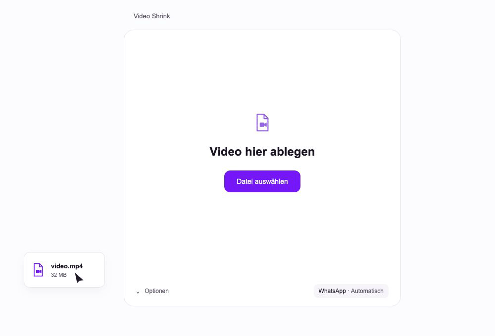

A small desktop app that compresses videos locally for sharing. Built with Flutter
for **macOS, Windows and Linux**.



<sub>Illustrated workflow, rendered with Remotion. File sizes are examples.</sub>

- Drop one video or choose a file. Compression starts automatically.
- Orientation, proportions and duration determine the recommended settings.
- Choose a small 15 MB target or a 64 MB profile with more quality.
- Originals stay intact. Existing files are never overwritten. No video uploads.

## Try it

This is an early development version. The desktop UI currently uses German.
GitHub Actions builds development packages for all three systems. These packages
**do not include FFmpeg yet** and are not signed distribution releases.

With Flutter 3.44.7 and FFmpeg/FFprobe available:

```sh
flutter pub get
flutter run -d macos
# On the matching system: -d windows or -d linux
```

For the browser design preview, run `npm run dev` and open
`http://127.0.0.1:4318`. The browser uses example data and simulates conversion;
actual video processing runs in the desktop app.

## Develop

`npm run verify` runs analysis and tests. FFmpeg integration tests use generated
fixtures and are skipped if FFmpeg/FFprobe are unavailable.

See [building and packaging](BUILDING.md) for native build commands, FFmpeg
requirements and sandbox details. The cover and [demo source](media/index.tsx)
are editable graphics, without generated imagery.

MIT for the app source. Flutter, FFmpeg and Remotion have their own licenses.
The size profiles are sharing presets, not a guarantee of acceptance by every
WhatsApp client or upload method.
